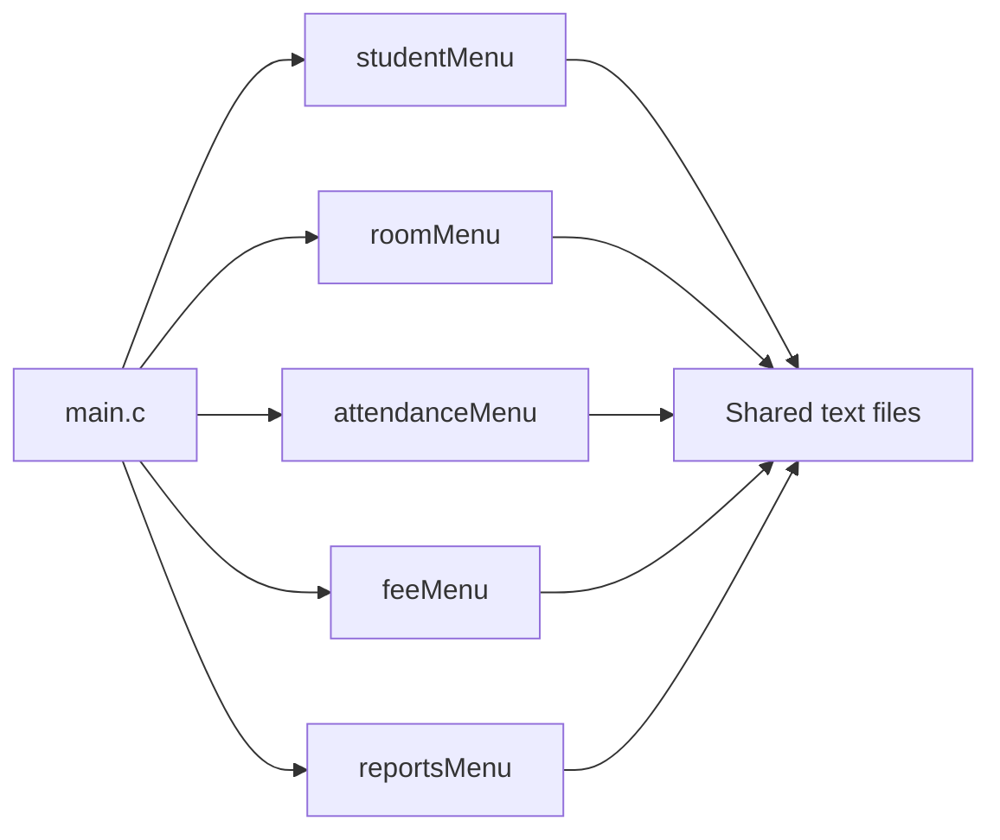

# Lecture alignment and module integration

The application uses the core C concepts in the five supplied lectures. Some
shared file-safety and platform helpers extend those notes. This is a mapping
of the implemented concepts, rather than a claim that every helper appears in
the slides. References below use physical PDF page numbers.

| Lecture | Covered concepts and pages | Examples in this project |
| --- | --- | --- |
| 07 — Functions in C | Modular decomposition (3), prototypes/calls (15–20), passing arguments (44–50) | `main.c` calls each member's menu through its header; helpers accept parameters and return results |
| 08 — Arrays in C | Arrays and bounds (5–16), array parameters (29–32), strings/comparison (35–41) | Room/allocation arrays, bounded ID/name character arrays, string comparisons |
| 09 — Pointers in C | Pointer arguments and arrays (14–21), dynamic allocation (22–24) | `int *` output parameters, structure pointers, growing record arrays using `realloc`, cleanup using `free` |
| 10 — File Handling in C | Standard streams (10–12), `FILE *`/opening/reading (18–29), writing/closing (35–43), line/block operations (55–61) | Shared `.txt` records, `fopen`, character/line reading, `fprintf`, `fclose`, EOF and error handling |
| 11 — Structures in C | Structures, `typedef`, structure arrays and arguments (4–23), structure/file records (24–28), global/static scope (36, 42–44) | Student, room, allocation, attendance, payment and profile structures; module-private helper functions/state |

Dynamic memory is explicitly in Lecture 09: `malloc`, `calloc`, `free`, and
`realloc` are listed on pages 22–24. Using dynamic arrays here follows that
topic. Persistent records are readable text, including the temporary recovery
journal; the application does not store native structures as binary records.

## How the independently written modules work together

- The application build links one `main()`. Each member module exposes its
  menu in a `.h` file and keeps its implementation in the matching `.c` file.
  `Makefile` compiles and links those sources together. The fee-only example
  main stays outside the application build.
- Startup selects one data directory, recovers any pending room update, and
  creates only missing required text files. All member modules use that same
  directory; existing records are preserved.
- Student IDs use one validation/normalization rule. Registration supplies
  current names; room allocation supplies the actual room. Fee profiles do
  not store a second copy of either value.
- Attendance and reports share the same latest-record leave calculation.
  Payments and reports share the same exact-cent money rules.
- Readable text formats are explicit: student/profile/history records use
  pipes; room/allocation/payment records use whitespace. The documented legacy
  attendance/profile readers support the older supplied formats.

## Concepts extending the five notes

The shared startup/save code also uses Ubuntu/POSIX operations such as
`chdir`, `readlink`, `stat`, `mkstemp`, `fdopen`, and `fsync`. Recovery journaling,
`qsort` callbacks, binary-search indexes, and calendar validation are additional
implementation techniques. They support the existing validation, performance,
and save/recovery behavior. They are not required to understand each member's
core registration, allocation, attendance, fee, or report calculation.

Lecture 07 page 21 demonstrates including another `.c` file directly. This
project uses header declarations and separately linked `.c` files instead;
that is valid C organization and prevents duplicate definitions. Python tests
and Make are development tools; the application itself is C.

## A coherent demonstration

Run `make demo` to start all five modules using a fresh copy of
`examples/demo-data`. Its student IDs match across registration, allocations,
attendance, fee profiles, and payments. The two synthetic students occupy
rooms 101 and 202. Initial reports show two students, 50% occupancy, and one
student on leave. The historical demo leave is deliberately overdue.

The older samples in `data/` come from different module examples: their
attendance/payment IDs and an allocation ID are absent from the supplied
student register. Those original records are preserved. An imported payment
can only be edited after the exact student ID is registered; similarly spelled
IDs are not automatically merged.

For a fresh end-to-end demonstration, register `TGDEMO000003`, allocate the
remaining bed in room 101, mark attendance, create a fee profile, record a
payment, and open reports. The integration tests exercise this complete path,
as well as leave/return, room changes, and persistence after restart.
